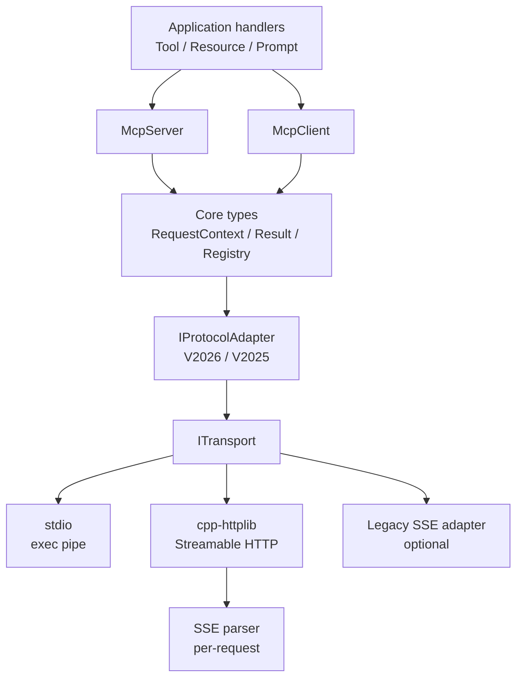

# C++ MCP 可复用库设计

> 状态：设计稿（未实现）。本文描述一个**独立、可复用、无 GUI 依赖的纯 C++17 MCP 库**，同时提供 server 与 client、stdio 与 Streamable HTTP 传输。所有 C++ 代码块都是**接口草图**，未编译、未加入任何构建文件；库本身不包含宿主应用/设备逻辑。
>
> 宿主应用适配边界见 [`host-adapter.md`](./host-adapter.md)；本文只描述库的通用能力；宿主专有映射只在 §21 作为适配边界说明。

---

## 1. 文档目的、范围、假设与术语

### 1.1 目的

回答三个问题：

1. 一个**可复用**的 C++ MCP 库应如何分层，才能同时支持 server/client、2026/2025 协议、stdio/HTTP 传输？
2. 哪些能力属于库核心，哪些必须留给应用（认证策略、审批、设备安全、审计、UI）？
3. 如何在不绑定 GUI 框架/宿主应用的前提下，让宿主应用以静态库 + 薄适配层接入？

### 1.2 范围

| 在范围内 | 不在范围内 |
|---|---|
| C++17 核心类型、JSON-RPC、错误模型 | 设备控制、业务算法、参数语义 |
| 2026-07-28 / 2025-11-25 协议适配 | 宿主的任务/硬件/业务规则 |
| stdio、Streamable HTTP server/client | 完整 OAuth/OIDC 授权服务器 |
| 可选 legacy HTTP+SSE 适配 | REST/OpenAPI 网关 |
| Schema 校验、canonical JSON、审计钩子 | UI 组件 |
| CMake 打包、3rd 依赖、测试/一致性 | 具体 Agent/Skill 产品 |

### 1.3 假设与固定决策

| # | 决策 |
|---|---|
| A1 | C++17；命名空间 `mcp::v1`；静态库优先。 |
| A2 | 核心无 GUI 依赖；库不提供任何 GUI 适配 target。 |
| A3 | `nlohmann/json` 表示 wire JSON；`cpp-httplib` 实现 HTTP/SSE。 |
| A4 | CMake（≥3.20）为唯一构建系统；不提供其它构建系统的适配文件。 |
| A5 | 传输：stdio + Streamable HTTP（server/client）；legacy HTTP+SSE 可选且默认关闭。 |
| A6 | 协议：2026-07-28 主，2025-11-25 回退；2025-06-18 不单独支持。 |
| A7 | Schema 校验可插拔；2020-12 默认用 jsoncons（可选），draft-07 可选 Valijson；测试用 `NullSchemaValidator`。 |
| A8 | 认证/审批/审计策略/设备安全由应用拥有；库只提供 hook 与上下文。 |
| A9 | 库不声称“强制设备安全”；安全结论必须由宿主应用/硬件层给出。 |
| A10 | 第三方依赖固定在 3rd/，版本/commit/SHA256 与许可证清单化；默认不使用系统包，也不使用 FetchContent。 |
| A11 | TLS 是构建开关（TUGMCP_TLS，默认 OFF）；要求 OpenSSL ≥ 3.0，不支持 1.1.1。 |

### 1.4 术语

| 术语 | 含义 |
|---|---|
| **MCP** | Model Context Protocol，JSON-RPC 2.0 上的工具/资源/提示协议 |
| **Era** | 协议代际：`V2025`（2025-11-25）、`V2026`（2026-07-28）、`Legacy2024`（可选） |
| **Streamable HTTP** | 单 `POST /mcp`，响应 JSON 或 SSE；2025 可有 session/GET/DELETE |
| **SSE** | Server-Sent Events；本文区分“legacy 双端点传输”和“HTTP 响应形态” |
| **Transport** | 字节/消息通道：stdio、HTTP、legacy SSE |
| **Adapter** | 把某一协议代际映射到统一 core 的组件 |
| **Handler** | 应用注册的 tool/resource/prompt 实现 |
| **Executor** | 执行 handler 的线程池/调度器 |
| **MRTR** | Multi-Round Trip Request；2026 `input_required`/`requestState` 流程 |
| **JCS** | RFC 8785 JSON Canonicalization Scheme |
| **ABI** | 二进制接口；本文用 pimpl/稳定签名控制 |
| **TLS 开关** | `TUGMCP_TLS`；只在 `tugmcp::http` 上传播 `CPPHTTPLIB_OPENSSL_SUPPORT` |
| **3rd/** | 仓库内置第三方源码目录，经 INTERFACE target 暴露 |

### 1.5 与宿主应用文档的关系

| 文档 | 角色 |
|---|---|
| 本文 | 通用库 API/协议/传输/打包 |
| [`host-adapter.md`](./host-adapter.md) | 宿主适配边界：执行器、UI 调度、安全/审批、工具映射 |
| 宿主应用自身设计文档 | 外部文档，不属于本仓库 |

> 结论：**库 = 协议与传输引擎；宿主应用 = 业务服务 + 安全/审批/设备适配**。库不得包含宿主业务/设备类型。

---

## 2. 目标与非目标

### 2.1 目标

| 目标 | 可验收表现 |
|---|---|
| 可复用 | 新项目只依赖 `tugmcp::core`/`tugmcp::http`，不引入宿主应用类型/GUI 框架 |
| 无 GUI 依赖 core | `core` 的编译单元不 include 任何 GUI 框架或宿主头 |
| Server + Client | 同一库提供 `McpServer`/`McpClient`，共享协议/类型/传输 |
| 双协议 | 2026-07-28 主，2025-11-25 回退；同一 handler 可复用 |
| stdio + HTTP | 本地进程与网络两种部署；可替换 transport |
| 可测试 | Fake transport、loopback、conformance suite |
| 可打包 | CMake targets、3rd 依赖、可选依赖；默认构建产物为静态库；发布由脚本生成的单头 artifact；split-header `TUGMCP_HEADER_ONLY` 模式未实现 |
| 可演进 | 协议常量/适配器隔离；pimpl/ABI 策略 |

### 2.2 非目标

| 非目标 | 原因 |
|---|---|
| 设备控制/业务算法/参数调优 | 属于宿主应用层 |
| GUI/UI 框架 | 核心不依赖任何 GUI 框架 |
| OAuth/OIDC 授权服务器 | 库只消费 token/提供 hook |
| 默认开启 legacy HTTP+SSE | 已 deprecated，增加攻击面/维护成本 |
| REST/OpenAPI | MCP 是 JSON-RPC，不引入第二套语义 |
| 强制设备安全/审批 | 应用/硬件负责；库不能替应用做安全结论 |
| 官方 SDK 兼容承诺 | 没有官方 C++ SDK；以规范与 conformance 为准 |

---

## 3. 设计原则

| 原则 | 具体做法 |
|---|---|
| **Transport-agnostic core** | core 只依赖 `ITransport`/`IMessageSink`，不 include cpp-httplib/OS pipe |
| **协议适配器隔离** | `IProtocolAdapter` 的 2026/2025 实现独立；core 不写 `if (version==...)` 散落逻辑 |
| **显式所有权** | `shared_ptr` 拥有 server/client/transport；sink 非拥有；stop 后再释放 |
| **Error-as-value** | `Result<T,McpError>`/`Status`；不让异常穿过 transport/线程边界 |
| **线程安全边界** | 一条 transport 一个 reader/writer；handler 在 executor；共享 JSON 不跨线程写 |
| **依赖注入** | `ISchemaValidator`/`IAuthenticator`/`IExecutor`/`ITransportFactory` 由调用方注入 |
| **可插拔安全** | auth/approval/audit hook；库不内置策略 |
| **无全局可变状态** | 不设进程级单例；每个 server/client 自有状态 |
| **ABI/pimpl** | 公共头只暴露稳定接口/值类型；实现细节放 `Impl` |

---

## 4. 协议与传输矩阵

### 4.1 2026-07-28 vs 2025-11-25

| 能力 | 2025-11-25 | 2026-07-28 | 库处理 |
|---|---|---|---|
| 初始化 | `initialize` 握手 | 无 `initialize`；`server/discover` | 适配器各自实现 |
| Session | `MCP-Session-Id` | 无 session | 2025 `SessionStore`；2026 无 |
| 服务端请求 | 支持 server→client 请求（按能力） | **不发起 server 请求**；用 MRTR/`input_required` | 2025 adapter 处理；2026 只做请求内 MRTR |
| GET/DELETE | 可选 | 405 | 2025 可开关；2026 明确 405 |
| Last-Event-ID | per-stream 可选 | 无 | 2025 保存有界 replay；2026 重新订阅 |
| `resultType` | 无 | 有 | 2026 result builder 必填 |
| cache | 无 `ttlMs/cacheScope` | 有 | 2026 list/read 结果带 |
| 订阅 | `resources/subscribe` 等 | `subscriptions/listen` + `params.notifications` 布尔 filter（D18） | 2026 adapter；2025 兼容 |
| MRTR | 无 | `input_required`/`requestState` | 2026 adapter |
| JSON-RPC batch | 2025-06-18 起移除 | 不允许 | 两种都拒绝 batch |
| HTTP+SSE 旧传输 | 兼容 | deprecated | 仅 legacy adapter |

> 2026 的核心是 **stateless**：没有 initialize/session/GET SSE/Last-Event-ID/ping；客户端用 `server/discover` 获取能力。2025 仍广泛部署，作为回退。
>
> 2025-06-18 不单列 target；如某客户端只差极小字段，可在 2025 adapter 上加 compat flag 复用，但必须 conformance 验证，不承诺完整支持。

### 4.2 传输矩阵

| 传输 | 角色 | 适用场景 | 取舍 |
|---|---|---|---|
| **stdio** | server + client | 桌面/CLI/同机子进程；最低依赖 | 无网络认证；stdout 必须纯净；Windows 需 binary mode |
| **Streamable HTTP server** | server | 宿主应用内嵌/本机服务/远程（加代理） | 需要 HTTP/SSE、auth/Origin、连接管理 |
| **Streamable HTTP client** | client | Agent 连接远程/本机服务 | 需要 session/reconnect/SSE 解析 |
| **Legacy HTTP+SSE** | server + client | 只兼容旧客户端 | 双端点 `/sse`+`/messages`；默认关闭；弃用风险 |
| WebSocket | 不支持 | — | 不是 MCP 标准传输，不引入 |

**SSE 歧义澄清：**

- 被废弃的是 **legacy HTTP+SSE 双端点传输**（`GET /sse` + `POST /messages`）。
- **SSE 作为 Streamable HTTP 的响应形态仍然有效**：`POST /mcp` 可返回 `text/event-stream`，用于请求内 progress 或订阅流。
- 库不会把“所有事件”都塞进 SSE；默认是拉取/请求内推送。

### 4.3 版本选择

```text
server: supportedVersions = { 2026-07-28, 2025-11-25 }
client: prefer 2026-07-28; if server rejects/unsupported -> 2025-11-25
legacy: 仅在显式启用 LegacySseTransport 时使用 2024-11-05
```

版本协商由 `IProtocolAdapter` 返回；core 不根据字符串分支写业务逻辑。

---

## 5. 总体架构



| 组件 | 职责 | 不负责 |
|---|---|---|
| `McpServer` | 注册 handler、dispatcher、协议适配、生命周期 | 设备/审批策略 |
| `McpClient` | 发现/初始化、请求/响应、通知、订阅、取消 | 业务语义 |
| `IProtocolAdapter` | 2026/2025 消息映射、header/_meta、resultType、MRTR | 传输/线程 |
| `ITransport` | 字节/消息收发、framing、关闭 | JSON-RPC 语义 |
| `SchemaValidator` | `inputSchema`/`outputSchema` 校验 | 业务校验 |
| `Executor` | handler 调度/线程池 | 协议 |
| `Auth/Audit hooks` | 身份/审计扩展点 | 内置策略 |

时间源通过 `ITimeSource` 注入（归 `tugmcp::core`，不新增 target）：

```cpp
class ITimeSource {
public:
    virtual ~ITimeSource() = default;
    virtual std::chrono::steady_clock::time_point now() = 0;
};
```

**硬约束：** 所有超时/ttl/重试判定必须经 `timeSource->now()`；`detail/` 与 `src/` 内禁止直接调用 `std::chrono::steady_clock::now()`（系统默认实现除外）。

同一对象树以 **transport options 的 `timeSource`** 为准；`ServerOptions`/`ClientOptions` 的同名字段仅在对应 transport options 的 `timeSource` 为 `nullptr` 时生效。

---

## 6. 模块与目录布局

```text
include/tugmcp/
  core.hpp               // umbrella：version/error/message/registry 等公共类型
  version.hpp            // ProtocolVersion/Era, supported versions
  error.hpp              // McpError/Result/Status/error codes
  message.hpp            // Request/Response/Notification/RequestId
  capabilities.hpp       // Client/Server capabilities
  request_context.hpp    // RequestContext
  security.hpp           // AuthContext/IAuthenticator/IAuthorizer/Approval/Audit（D20）
  cancellation.hpp       // CancellationToken
  transport.hpp          // ITransport/IMessageSink/ITransportFactory
  server.hpp             // McpServer/ServerOptions/IToolHandler/...
  client.hpp             // McpClient/ClientOptions/CallOptions
  tool.hpp               // ToolDescriptor/ToolResult/ToolRegistry
  operation.hpp          // ResultType/OperationOutcome/Page/ListParams/Progress/IProgressSink
  resource.hpp           // ResourceDescriptor/ResourceContent/ResourceTemplate/IResourceProvider
  prompt.hpp             // PromptDescriptor/PromptResult/IPromptProvider
  schema_validator.hpp   // ISchemaValidator + Null/Jsoncons/Valijson
  authenticator.hpp      // IAuthenticator/IAuthorizer/IAuditHook/IApprovalHook
  canonical_json.hpp     // JCS/stable subset + tool_schema_hash
  transport/stdio.hpp    // 无第三方依赖
  transport/http.hpp     // 仅声明 TlsOptions / StreamableHttp* / 工厂；不含 cpp-httplib
  transport/legacy_sse.hpp // 可选 legacy HTTP+SSE（TUGMCP_ENABLE_LEGACY_SSE=ON）
  detail/http_httplib.hpp // 单头实现唯一 include cpp-httplib 的实现头
  protocol/v2026.hpp
  protocol/v2025.hpp
  schema/{jsoncons,valijson,null}.hpp // 各自仅在对应可选 target 中 include 第三方
src/
  core/                  // dispatcher, registry, result, context
  protocol/v2026/        // stateless adapter, server/discover, subscriptions/listen
  protocol/v2025/        // initialize/session, GET/DELETE, replay
  transport/stdio/       // line framing, Windows binary mode
  transport/streamable_http_server/
  transport/streamable_http_client/
  transport/legacy_sse/  // optional
  transport/sse_parser/
  schema/                // jsoncons/valijson/null adapters
tests/
  unit/ integration/ conformance/
examples/
  echo_server/ echo_client/
CMakeLists.txt
3rd/                     // vendored 第三方源码（见 §20.2）
LICENSES/                // 聚合许可证（REUSE 风格）
```

> 公共头**只允许** include `nlohmann/json`（`Json` 暴露）与对应可选 schema target 的第三方头；`core/server/client/transport/http.hpp` **永不** include cpp-httplib。`transport/http.hpp` 不随 TLS/构建模式变化，`TlsOptions` 字段**无条件存在**。目录 `include/tugmcp/` 是发行名，命名空间 `mcp::v1` 是符号域，二者不同是有意的。

### 6.1 CMake targets

| target | 内容 | 依赖 | link deps / 作用域 |
|---|---|---|---|
| `tugmcp::core` | 类型、dispatcher、registry、stdio、协议适配、canonical JSON | nlohmann/json（3rd/nlohmann_json） | `Threads::Threads` PUBLIC；**INTERFACE include `tugmcp_3rd_json`**（公共头暴露 `Json`）；`find_dependency(Threads)`/`find_dependency(nlohmann_json)` 仅未来启用 install 时 |
| `tugmcp::http` | Streamable HTTP server/client、SSE parser、legacy adapter | `tugmcp::core`、cpp-httplib | `tugmcp::core`；`tugmcp_3rd_httplib` 编译模式 PRIVATE（单头消费方提供外部头）；Windows `ws2_32`（TLS 时 `crypt32`）；TLS 时 `OpenSSL::SSL`+`OpenSSL::Crypto`（编译模式 PRIVATE/`LINK_ONLY`）；`find_dependency(OpenSSL)` 仅未来启用 install 时 |
| `tugmcp::schema_jsoncons` | 2020-12 校验 | `tugmcp::core`、jsoncons（可选） | `tugmcp::core` + 对应 3rd target **INTERFACE include**；宏 PRIVATE |
| `tugmcp::schema_valijson` | draft-07 校验 | `tugmcp::core`、Valijson（可选） | `tugmcp::core` + 对应 3rd target **INTERFACE include**；宏 PRIVATE |
| `tugmcp::tests` | **INTERFACE helper 库**：fake transport / conformance helpers / fixture 头 | doctest（单头；测试设计见 [`testing.md`](./testing.md)） | **INTERFACE 传播 `tugmcp_3rd_doctest`** |

v1 只保证静态库；单头消费使用生成的 release artifact（`tugmcp.hpp`/`tugmcp_http.hpp`/`tugmcp_http_tls.hpp`）。split-header `TUGMCP_HEADER_ONLY=ON` 的 INTERFACE 模式未实现（FATAL）。`tugmcp::core` 不链接 GUI 框架/cpp-httplib。

---

## 7. 核心类型与错误模型

> 以下代码是接口草图，未编译。`Json = nlohmann::json`；C++17。

### 7.1 基础类型

```cpp
namespace mcp::v1 {

using Json = nlohmann::json;

struct RequestId {
    std::variant<std::string, std::int64_t, std::uint64_t> value;
    bool isString() const;
    bool isInt() const;
    Json toJson() const;
};

struct ProtocolVersion {
    int year = 0, month = 0, day = 0;
    std::string toString() const; // "2026-07-28"
    static std::optional<ProtocolVersion> parse(std::string_view);
};

enum class ProtocolEra { Legacy2024, V2025, V2026 };
enum class ListKind { Tools, Prompts, Resources };

struct Method { std::string value; };

using ProgressToken = std::variant<std::string, std::int64_t>;
struct Progress {
    ProgressToken token;
    double progress = 0.0;
    std::optional<double> total;
    std::string message;
};
enum class CancelMode { Auto, CloseStream, Notification };

using SubscriptionId = std::string;  // 2026 listen 请求的 JSON-RPC id 的字符串形式（D18）
struct SubscriptionFilter {
    std::vector<ListKind> listChanged;      // 空 = 不订阅 list_changed
    std::vector<std::string> resources;     // 2025 用；2026 非空 → -32602（D18）
};

struct AuthContext {
    std::string principal;
    std::vector<std::string> roles;
    std::string remoteAddress;   // HTTP/stdio 对端（可脱敏）
    std::string origin;          // HTTP Origin，stdio 为空
    Json claims;                 // token 解出的声明，已脱敏
};

struct TraceContext {
    std::string traceId;
    std::string spanId;
    std::string requestId;       // 应用/网关 id，不等于 JSON-RPC id
};

struct RequestContext {
    RequestId id;
    Method method;
    AuthContext auth;            // transport 认证结果（D20）
    std::string sessionId;       // 2025 `MCP-Session-Id`（2026 为空；D19）
    Json inputResponses;         // MRTR retry 的客户端输入
    Json clientCapabilities;     // 2026 `_meta["io.modelcontextprotocol/clientCapabilities"]`（D18）
    std::optional<std::string> requestState;
    std::optional<RequestId> subscriptionId; // 订阅流上下文（D18）
    std::shared_ptr<CancellationToken> cancellation;
    // version/era/meta/auth/trace 随 P3/P4 加入；当前实现只保留以上字段。
};

struct ClientInfo { std::string name, version; };
struct ClientCapabilities { bool sampling = false, roots = false, elicitation = false; Json raw; };
struct ServerCapabilities { bool tools = false, resources = false, prompts = false, logging = false; Json raw; };
struct ServerInfo { std::string name, version; };
struct DiscoverResult {
    std::vector<ProtocolVersion> supportedVersions;
    ServerInfo serverInfo;
    std::string instructions;
    Json capabilities;
};
struct InitializeResult {
    ProtocolVersion negotiated;
    ServerInfo serverInfo;
    std::string instructions;
    Json capabilities;
};

template <class T>
struct Page {
    std::vector<T> items;
    std::string nextCursor;        // empty = no more
    std::uint32_t ttlMs = 0;       // 2026 list cache
    std::string cacheScope;
};

} // namespace mcp::v1
```

### 7.2 结果与错误

```cpp
enum class ErrorCode : int {
    ParseError          = -32700,
    InvalidRequest      = -32600,
    MethodNotFound      = -32601,
    InvalidParams       = -32602,
    InternalError       = -32603,
    HeaderMismatch      = -32020,
    UnsupportedVersion  = -32022,
    MissingRequiredClientCapability = -32021,
    // 应用域错误从 -32000 起，库不占用
};

struct McpError {
    ErrorCode code = ErrorCode::InternalError;
    std::string message;
    Json data;
    bool retryable = false;
};

template <class T>
struct Result {
    bool ok = false;
    T value{};
    McpError error;
    static Result success(T v);
    static Result failure(McpError e);
};

struct Status {
    bool ok = false;
    McpError error;
    static Status success();
    static Status failure(McpError e);
};
```

| 错误层 | 使用 |
|---|---|
| JSON-RPC | `-32700/-32600/-32601/-32602/-32603`；协议 header/version `-32020/-32022`；缺少客户端能力 `-32021`（不是认证失败） |
| HTTP auth | 认证失败走 HTTP 401（或应用定义的 `McpError`）；不得用 JSON-RPC `-32021` 表示“未授权” |
| Tool result | 业务失败 `isError=true` + `structuredContent.error`，不是 JSON-RPC error |
| HTTP | 只用于传输/认证/路径/限流；MCP 端点内的 JSON-RPC 错误通常仍 200（header/version 例外，见 §10） |

**本地/传输配置错误：** 本地/传输配置错误**不进入 JSON-RPC 响应**，只以 `Result`/`Status` 返回调用方。统一使用 `ErrorCode::InternalError(-32603)` + `data.reason` 枚举：`tls_not_built` / `tls_not_configured` / `unsupported_scheme` / `tls_handshake_failed` / `option_invalid`。发生时点按下表：创建/`start()` 阶段返回 `Result`，握手失败在首个请求（client）或连接建立（server）阶段上报；`data` 只放 reason 与配置项名，不放凭据。库只使用 MCP 分配的 `-32020/-32021/-32022`，其余错误码留给应用。

| 条件 | reason | 观测点 |
|---|---|---|
| `TlsOptions::enabled=true` 且构建 `TUGMCP_TLS=OFF` | `tls_not_built` | 传输创建期 `Result` |
| server `enabled=true` 缺 cert/key | `tls_not_configured` | 传输创建期 `Result` |
| cert/CA/SNI 路径非法，或 TLS 字段组合互斥 | `option_invalid` | 传输创建期 `Result` |
| client `baseUrl` 为 `https://` 且未启用 TLS | `unsupported_scheme` | 传输创建期 `Result`，不发网络请求 |
| TLS 握手/证书校验失败 | `tls_handshake_failed` | **client**：首个请求的 `Result`；**server**：连接级经 `IMessageSink::onError`，不产生 JSON-RPC 响应 |

### 7.3 `resultType` 与工具结果

```cpp
enum class ResultType { Complete, InputRequired };

struct ToolDescriptor {
    std::string name, title, description;
    Json inputSchema, outputSchema, annotations;
    bool idempotent = false;
};
struct ResourceDescriptor {
    std::string uri, name, title, description, mimeType;
    std::uint64_t size = 0;
    Json annotations;
    std::uint32_t ttlMs = 0;
};
struct ResourceTemplate { std::string uriTemplate, name, description, mimeType; }; // ttlMs/cacheScope 在 Page envelope
struct ResourceContent { std::string uri, mimeType; Json text, blob; ResultType resultType = ResultType::Complete; std::uint32_t ttlMs = 0; std::string cacheScope; };
struct PromptDescriptor { std::string name, description; Json arguments; };
struct PromptResult { std::string description; Json messages; ResultType resultType = ResultType::Complete; };

struct ContentBlock {
    enum class Type { Text, Image, Audio, ResourceLink, EmbeddedResource };
    Type type = Type::Text;
    std::string text;             // Text
    std::string mimeType;         // Image/Audio/Resource
    std::string dataBase64;       // Image/Audio
    std::string uri;              // ResourceLink/EmbeddedResource
    Json annotations;
};

struct ToolResult {
    bool isError = false;
    ResultType resultType = ResultType::Complete;
    std::vector<ContentBlock> content; // 不是 text-only
    Json structuredContent;
    std::uint32_t ttlMs = 0;
    std::string cacheScope;
};

struct InputRequired {
    std::optional<Json> inputRequests;      // 需要客户端补充的输入
    std::optional<std::string> requestState; // 服务端状态，客户端必须原样回传
    bool valid() const { return inputRequests.has_value() && requestState.has_value(); }
};
template <class T>
struct OperationOutcome { std::variant<T, InputRequired> value; };
using ToolOutcome = OperationOutcome<ToolResult>;
using ResourceOutcome = OperationOutcome<ResourceContent>;
using PromptOutcome = OperationOutcome<PromptResult>;
```

`ToolResult`/`ResourceContent`/`PromptResult` 与 `InputRequired` 用 `OperationOutcome<T>` 包装；`InputRequired` 的 `inputRequests`/`requestState` **必须同时存在**（缺任一则无法完成 MRTR 重试）。**MRTR 重试是客户端发起的新请求，新 JSON-RPC id 由客户端选择**，服务端不指定 id；库只负责编码/路由，不决定业务。

### 7.4 严格 JSON

| 规则 | 处理 |
|---|---|
| Duplicate keys | 拒绝；SAX/预解析检测同层重复 key |
| `id` 类型 | 只接受 string/int64/uint64；float/bool/null 拒绝 |
| UTF-8 | 校验；非法序列拒绝（`-32700` 或 `-32600`） |
| NaN/Inf | 拒绝；wire 不允许 |
| Batch | 拒绝（2025-06-18 起移除） |
| 超大消息 | 由 transport 的 `maxMessageBytes` 限制 |
| 数字 | `int64` 不经过 double；保留整数语义 |

---

## 8. 传输抽象

```cpp
enum class TransportKind { Stdio, StreamableHttp, LegacySse };

enum class SendResult { Accepted, QueueFull, Closed };

class IMessageSink {
public:
    virtual ~IMessageSink() = default;
    virtual void onMessage(Json&& message) = 0;
    virtual void onError(const McpError& error) = 0;
    virtual void onClose() = 0;
};

class ITransport {
public:
    virtual ~ITransport() = default;
    virtual TransportKind kind() const = 0;
    virtual Status start(IMessageSink& sink) = 0; // sink 必须比 transport 活得久
    virtual SendResult send(const Json& message) = 0;
    virtual void stop() = 0;                       // 幂等
};

struct TransportConfig {
    std::size_t maxMessageBytes = 4 * 1024 * 1024;
    std::size_t sendQueueCapacity = 256;
};

class ITransportFactory {
public:
    virtual ~ITransportFactory() = default;
    virtual std::shared_ptr<ITransport> create(const TransportConfig&) = 0;
};
```

| 项 | 约定 |
|---|---|
| 所有权 | server/client 拥有 transport；sink 非拥有；`stop()` 后不再回调 |
| 线程 | 每个 transport 恰好一个 reader、一个 writer；`send` 线程安全 |
| 背压 | `send` 返回 `QueueFull`；不允许无限缓存 |
| 关闭 | `stop` 先停读、再停写、最后 `onClose`；幂等 |
| 错误 | 传输错误通过 `onError`；协议错误由 adapter 生成 JSON-RPC error |
| framing | stdio 用 newline；HTTP 用 Content-Length/chunked；SSE 用 event/data/id |

---

## 9. stdio 设计

| 项 | 设计 |
|---|---|
| framing | newline-delimited **compact JSON**；一行一条消息；禁止 pretty print |
| stdout | 只写协议消息；日志/诊断写 stderr |
| stderr | 人类日志；不得包含 token/敏感参数 |
| Windows | `_setmode(_fileno(stdin/stdout), _O_BINARY)`；UTF-8 |
| EOF | 读端 EOF → 关闭；server 退出；client 收到 `onClose` |
| 最大消息 | `maxMessageBytes` 默认 4MiB；超限返回错误并关闭 |
| 线程 | 单 reader + 单 writer；写队列有界 |
| server 角色 | 从 stdin 读请求，向 stdout 写响应/通知 |
| client 角色 | 可启动子进程，向 stdin 写请求、从 stdout 读响应 |
| 2025 server requests | 2025 adapter 可发 server→client 请求（按能力） |
| 2026 server requests | 2026 adapter **不发起** server 请求；用 MRTR `input_required` 表达 |

> stdio 没有内建认证/Origin；进程边界由 OS 用户/父进程控制。库不声称 stdio 是“安全隔离”。

---

## 10. Streamable HTTP server

### 10.1 端点与响应

| 项 | 2025-11-25 | 2026-07-28 |
|---|---|---|
| `POST /mcp` | 需要 | 需要 |
| `Accept` | `application/json, text/event-stream` | 同 |
| 响应 | JSON 或 SSE | JSON 或 SSE |
| `GET /mcp` | 可选 SSE stream | **405** |
| `DELETE /mcp` | 可选终止 session | **405** |
| Session | `MCP-Session-Id` | 无 |
| 版本 header | `MCP-Protocol-Version` | `MCP-Protocol-Version` 必须等于 `params._meta["io.modelcontextprotocol/protocolVersion"]`；缺失/不一致 → 400 + `-32020` |
| `Mcp-Method`/`Mcp-Name` | 不要求/视实现 | 必须校验 |

**2026 请求校验（D18）**：`params._meta` 必须含 `io.modelcontextprotocol/protocolVersion` 与 `io.modelcontextprotocol/clientCapabilities`；缺失/类型错 → `-32602` + HTTP 400。`initialize`/`ping`/`logging/setLevel`/`resources/subscribe`/`resources/unsubscribe`/未知方法 → HTTP 404 + `-32601`。错误一律回显请求 id。

### 10.2 组件

```cpp
enum class AdmissionDecision { Accept, Reject, Emergency };
class IAdmissionHook {
public:
    virtual ~IAdmissionHook() = default;
    virtual AdmissionDecision admit(const RequestContext&, const Json& request) = 0;
};

struct TlsOptions {
    bool enabled = false;            // 必须与构建开关一致
    std::string certChainPath;       // server 必填（enabled）；client 侧用于 mTLS
    std::string privateKeyPath;      // server 必填（enabled）；client 侧用于 mTLS
    std::string privateKeyPassword;  // 可选
    std::string clientCaFile;        // 可选，双向 TLS（server 校验客户端）
    bool verifyPeer = true;          // client-only
    std::string caBundlePath;        // client-only；可选；默认系统根
    std::string serverName;          // client-only SNI，可选
    std::string minVersion = "TLS1.2";
};

struct StreamableHttpServerOptions {
    std::string bind = "127.0.0.1";
    int port = 0;
    std::size_t maxBodyBytes = 1 * 1024 * 1024;
    std::size_t maxConcurrentStreams = 8;
    std::size_t perStreamQueue = 256;
    bool enable2025Session = true;
    std::shared_ptr<IAdmissionHook> admission; // 传输层限流/紧急请求准入
    std::string emergencyPath = "/emergency";
    bool dedicatedEmergencyListener = false;
    std::vector<std::string> allowedHosts;    // 空 = 仅 loopback Host（D18）
    std::vector<std::string> allowedOrigins;  // 空 = 仅缺失/loopback Origin（D18）
    std::vector<std::string> supportedVersions; // 由 McpServer 从 ServerOptions 推送（D18）
    TlsOptions tls;                  // 无条件存在
    std::shared_ptr<ITimeSource> timeSource; // nullptr = 系统时钟；无条件字段
    // schema/auth/executor 归 ServerOptions，避免重复所有权
};

Result<std::shared_ptr<ITransport>> makeStreamableHttpServerTransport(
    const StreamableHttpServerOptions&);

class SessionStore;   // 2025 only
class StreamRegistry; // session/request -> SseSink
class SseSink {       // 有界队列 + 单 writer
public:
    virtual SendResult send(const Json& notification,
                            std::optional<std::string> eventId = std::nullopt) = 0;
    virtual void close() = 0; // 2026 explicit close；2025 可保留 replay buffer
};
```

**TLS 失败语义：** server 侧 TLS 握手失败是连接级的，经 `IMessageSink::onError` 上报，不产生 JSON-RPC 响应；client 侧握手失败映射到首个请求的 `Result`。`certChainPath`/`privateKeyPath` 在 client 侧用于 mTLS；`serverName`/`verifyPeer`/`caBundlePath` 为 client-only。

**配置所有权：** `ServerOptions` 拥有 schema/auth/authorizer/audit/approval/executor、`instructions`、`enableLegacySse`；`StreamableHttpServerOptions` 只保留传输参数（bind/port/body/stream limits/admission/emergency path），**TLS 归传输 options**（`TlsOptions tls`）；`ClientOptions` 拥有客户端 auth 与 `prefer`。不要在两处重复注入同一个对象。

**TLS 宏作用域与守卫：** `CPPHTTPLIB_OPENSSL_SUPPORT` + `TUGMCP_TLS_ENABLED`(0/1) 在编译模式下为 **PRIVATE**（只作用于 `src/transport/*.cpp`，`OpenSSL::*` 亦为 PRIVATE，经 `$<LINK_ONLY:>` 传给最终链接）；单头 TLS artifact 在实现段依赖自身发出的宏；split-header `TUGMCP_HEADER_ONLY=ON` 的 INTERFACE 模式未实现。`detail/http_httplib.hpp` 使用三条 `#error` 守卫，抓 CMake/宏漂移：

```cpp
#ifndef TUGMCP_TLS_ENABLED
#error "TUGMCP_TLS_ENABLED must be defined by the tugmcp::http target"
#endif
#if TUGMCP_TLS_ENABLED && !defined(CPPHTTPLIB_SSL_ENABLED)
#error "TLS enabled but cpp-httplib built without SSL support"
#endif
#if !TUGMCP_TLS_ENABLED && defined(CPPHTTPLIB_SSL_ENABLED)
#error "cpp-httplib SSL enabled but TUGMCP_TLS is off"
#endif
```

**所有 TU 一律经 `detail/http_httplib.hpp` 单一入口 include httplib**（编译模式也如此）：该头按 `TUGMCP_TLS_ENABLED` 定义 `CPPHTTPLIB_OPENSSL_SUPPORT`，再 include `httplib.h`，最后用 `CPPHTTPLIB_SSL_ENABLED` 做一致性检查。任何 TU 直接 include `httplib.h` 都可能以不同宏实例化 httplib 的 inline 代码，链接期 COMDAT 折叠会选中错误的定义（曾导致 https 客户端抛 `'https' scheme is not supported`）。`detail/http_httplib.hpp` 因此不属于公共 API，只供 `tugmcp::http` 的消费者使用。

**诚实边界：** 单头 artifact **无法在链接期检测跨 TU 宏不一致**，因此每个看到 `httplib.h` 的 TU 必须使用同一 artifact/宏；不得声称运行期可检测。split-header `TUGMCP_HEADER_ONLY` 模式未实现。

| 项 | 设计 |
|---|---|
| 请求处理 | HTTP 线程只解析/校验/入队；handler 在 `IExecutor`，不阻塞 pool |
| SSE | 每个请求/订阅一个 `SseSink`+writer；有界队列；慢客户端断开 |
| Emergency | `IAdmissionHook` + `/emergency` 或 dedicated listener；绕过 rate limit/queue-full/owner，但仍受 executor 阻塞影响，不是硬实时 |
| 2026 GET/DELETE | 明确 405 |
| 2025 GET/DELETE | 可配置；GET 可恢复 per-stream；DELETE 终止 session |
| header/_meta | 缺失/畸形/不一致 → 400 + `-32020`；不支持版本 → 400 + `-32022` |
| Origin/auth | 应用 hook；不通过则 401/403 |
| Keepalive | SSE comment 或按规范；不伪造 ping |
| 关闭 | 停止接受新请求 → 取消/等待 handler → 关闭 SSE 流 → 关闭 transport → executor drain → join |
| cpp-httplib | 阻塞线程池；SSE 会占线程，必须限制 stream 数/独立 writer |

**Per-request SSE：** 只在请求带 `progressToken` 时发送 `notifications/progress`，最后发送 final response；**不做 unsolicited per-frame push**。资源订阅只在 2026 `subscriptions/listen` 或 2025 兼容路径中建立。

---

## 11. Streamable HTTP client

```cpp
struct StreamableHttpClientOptions {
    std::string baseUrl;              // http://127.0.0.1:port
    std::chrono::milliseconds requestTimeout{30000};
    std::size_t maxSseQueue = 256;
    TlsOptions tls;                   // 无条件存在
    std::shared_ptr<ITimeSource> timeSource; // nullptr = 系统时钟；无条件字段
    // auth/prefer 归 ClientOptions；这里只放传输参数
};

Result<std::shared_ptr<ITransport>> makeStreamableHttpClientTransport(
    const StreamableHttpClientOptions&);

class StreamableHttpClient {
public:
    virtual ~StreamableHttpClient() = default;
    // 传输层 HTTP：编码 request、解析 JSON/SSE、维护 pending/session
    virtual Result<Json> post(const Json& request, std::chrono::milliseconds timeout) = 0;
    virtual Result<SubscriptionId> openSubscription(
        const SubscriptionFilter&, std::function<void(const Json&)> onEvent) = 0;
    virtual Status cancel(const RequestId&, CancelMode = CancelMode::Auto) = 0;
    virtual void close() = 0;
};
```

> 以上是 **HTTP 传输层**；面向业务的高层 `McpClient`（list/call/subscribe）见 §15。
>
> client 侧 TLS 握手/证书校验失败映射到首个请求的 `Result`（`reason="tls_handshake_failed"`），不是 JSON-RPC 响应；`certChainPath`/`privateKeyPath` 用于 mTLS，`serverName`/`verifyPeer`/`caBundlePath` 为 client-only。

| 项 | 设计 |
|---|---|
| 2025 session | `initialize` 后保存 `MCP-Session-Id`；后续请求带 header |
| 2026 请求 | 带 `MCP-Protocol-Version`、`_meta`、`Mcp-Method`/`Mcp-Name`（按方法） |
| 响应 | `application/json` 直接完成；`text/event-stream` 由 SSE parser 驱动 |
| 通知 | `notifications/progress` 绑定 `progressToken`；`list_changed`/`resource_updated` 分发给回调 |
| 取消 | `cancel(id, mode)`：`Auto` 按 era 选择；2026 HTTP 用 `CloseStream` 关闭该 SSE response；2025 用规范 `Notification`；本地 timeout 也取消 pending |
| pending registry | 每个 request id 记录 sink/cancel/timeout；响应/取消/关闭时移除；重连后按 era 恢复 |
| 2025 恢复 | 保存 `Last-Event-ID`（per-stream，有界 replay）；重连按 stream 续传 |
| 2026 恢复 | 无 Last-Event-ID；重新 discover/订阅，用 `latest`/分页补齐；旧 pending 请求取消 |
| 连接 | **P2b 现状**：每次 `send` 创建独立 `httplib::Client`（活跃 client 由 weak_ptr 跟踪），以便订阅流与普通调用并行；取消按 request id 精确停止对应 client。**M4/M5 目标**：每 session 一个 client + 连接复用；禁止多线程并发复用同一 client |
| 背压 | SSE 队列有界；慢消费者丢弃/断开；不阻塞 IO 线程 |

> `httplib::Client` 不是线程安全的通用客户端；库必须为每个并发请求/会话隔离 client，或用显式 mutex 串行化。P2b 用 per-send client 换取隔离，连接复用/TLS 握手成本在 M4/M5 重新评估。

---

## 12. Legacy HTTP+SSE 适配（可选）

Legacy 2024-11-05 使用两个端点：

```text
GET  /sse       -> 长连接；首个 event: endpoint 给出 POST /messages 地址
POST /messages  -> JSON-RPC 请求；响应/通知通过 GET /sse 的 event: message 下发
```

| 项 | 设计 |
|---|---|
| 开关 | `LegacySseOptions{enabled=false}`；默认关闭 |
| Session | endpoint URL 绑定 session id；`SessionStore` 保存连接/队列 |
| framing | `event: endpoint` 一次；后续 `event: message` + JSON |
| Batch | legacy 适配器可为兼容接受 JSON-RPC batch；**core/2025/2026 一律拒绝**，不把 batch 带入新路径 |
| 角色 | server 与 client 都可适配；client 先 GET，再按 endpoint POST |
| 关闭 | 关闭 GET 流；POST 返回 410/503；清理 session |
| 风险 | 已 deprecated；两连接状态机复杂；不建议新部署 |
| 测试 | 只做兼容矩阵；不作为主验收路径 |

> Legacy 适配只实现 2024-11-05 的既有语义；不把 2025/2026 的新能力硬塞进去。

**P4 具体 wire 约定**：
- session id 为 32 hex；`GET /sse` 首帧 `event: endpoint`，data 为 `/messages?sessionId=<id>`。
- `POST /messages?sessionId=<id>` 接受单个 JSON-RPC 对象或 batch 数组；每个响应/通知作为独立 `event: message` + `data: <json>` 下发（batch 不合并成数组事件）。
- 缺失 session → 400；未知 session → 404；GET 流已关闭 → 410。
- 认证/Origin 策略与主 HTTP 传输一致；auth 失败 401。
- `TUGMCP_ENABLE_LEGACY_SSE=OFF` 时不构建该 target；不得影响 core/2025/2026 的 batch 拒绝语义。
- 客户端：先 GET /sse 解析 endpoint，再 POST；响应/通知经同一 SSE 回调；关闭时结束 GET 流。

---

## 13. 协议适配层

### 13.1 接口

```cpp
class IClientRequestResponder {
public:
    virtual ~IClientRequestResponder() = default;
    virtual void sendResult(const Json&) = 0;
    virtual void sendError(const McpError&) = 0;
};
using ClientRequestHandler =
    std::function<Result<Json>(const Json& request, IClientRequestResponder&)>;

class ClientEventSink {
public:
    virtual ~ClientEventSink() = default;
    virtual void onResponse(const Json&) = 0;
    virtual void onNotification(const Json&) = 0;
    virtual void onRequest(const Json& request, IClientRequestResponder&) = 0; // 2025
    virtual void onError(const McpError&) = 0;
};

class IProtocolAdapter {
public:
    virtual ~IProtocolAdapter() = default;
    virtual ProtocolEra era() const = 0;
    virtual ProtocolVersion version() const = 0;

    // 生命周期：2025 initialize / 2026 discover
    virtual Result<DiscoverResult> onDiscover(const Json& request, RequestContext&) = 0;
    virtual Result<InitializeResult> onInitialize(const Json& request, RequestContext&) = 0;

    // 服务端：把规范化请求映射为 handler 调用；返回 JSON-RPC result/error
    virtual Result<Json> dispatchServer(const Json& request, RequestContext&) = 0;
    // 客户端：把响应/通知映射为 core 事件
    virtual Status dispatchClient(const Json& message, ClientEventSink&) = 0;

    virtual Json makeResult(const Json& id, const Json& result, ResultType) = 0;
    virtual Json makeError(const Json& id, const McpError&) = 0;
    virtual Json makeProgress(const ProgressToken&, double, std::string_view message) = 0;
};
```

### 13.2 生命周期

| 阶段 | 2025-11-25 | 2026-07-28 |
|---|---|---|
| 启动 | 客户端 `initialize` → 服务端返回 capabilities/session | 客户端 `server/discover` → 服务端返回 capabilities |
| 版本协商 | initialize 参数 + header | `MCP-Protocol-Version` + `_meta` 一致；不支持 → `-32022` |
| Session | 创建/保存 `MCP-Session-Id` | 无 session |
| 运行 | 请求/响应 + 可选 GET stream | 请求/响应 + per-request SSE/订阅 |
| 订阅 | `resources/subscribe` 等 | `subscriptions/listen` + `params.notifications` 布尔 filter（D18） |
| 关闭 | DELETE session/关闭 stream | 关闭 SSE/HTTP；无 session 可删 |

**P3 实现约定（2025，本节为权威）**：
- `initialize` 响应头返回 `MCP-Session-Id`（不透明 32 hex）；此后 2025 `POST /mcp` 必须携带该头：缺失 → 400 + `data.reason="missing_session"`，未知/过期 → 404。
- `DELETE /mcp` 关闭该 session 的所有 stream 并返回 204；`GET /mcp` 打开 server→client SSE 流，事件带单调递增 `id:`；每个 session 至多一条活跃 GET 流，保留最近 256 条用于 `Last-Event-ID` replay（超出范围则从最早可用事件开始）。
- session 上限默认 128、过期默认 30 分钟（`ITimeSource` 驱动）；超限 → 429。
- server→client 请求：库生成 JSON-RPC id，经该 session 的 GET 流发送并等待 POST 回来的响应；API 为 `Result<Json> requestClient(sessionId, method, params, timeout)`；无活跃 GET 流 → `data.reason="no_session_stream"`；超时 → `data.reason="timeout"`。
- 主机通知：`Status sendNotification(sessionId, method, params)` 经 GET 流投递，用于 2025 `notifications/*` 与资源更新。
- 2026 请求忽略 session 头，仍走 stateless 路径。
- **客户端 2025**：transport 在 `initialize` 响应上捕获 `MCP-Session-Id` 并自动附加到后续请求；`connect()` 默认打开 GET 流（`ClientOptions::autoOpenStream`）；GET 流断线按 `Last-Event-ID` 重连（100ms→1s 退避）；server→client 请求由 `McpClient::setRequestHandler(method, handler)` 处理并回 POST；`setOnNotification` 接收流上的通知；`cancel(id, Notification)` 发送 `notifications/cancelled`（params 带原 request id），服务端据此取消对应 handler token。

### 13.3 关键映射

| 能力 | 库负责 | 应用负责 |
|---|---|---|
| 版本/header/`_meta` 校验 | 是 | 选择 supportedVersions |
| JSON-RPC 编解码/错误 | 是 | 业务错误码/文案 |
| Tool/Resource/Prompt 注册 | 是 | handler 语义/数据来源 |
| Schema 校验 | 是（可插拔） | 是否允许未校验工具 |
| Auth hook | 调用 | token 校验/角色策略/审批 |
| Audit hook | 提供上下文/事件 | 存储/保留/脱敏策略 |
| MRTR `input_required` | 编解码/路由 | 需要哪些输入/如何展示 |
| 订阅/stream | 注册/队列/背压 | URI 语义/数据更新 |
| 设备安全 | 否 | 宿主应用/硬件层 |

### 13.4 分页、缓存、MRTR

- **分页**：`listTools/listResources/listResourceTemplates/listPrompts` 支持 `cursor`；cursor 是不透明字符串，服务端注册表生成；库不解释业务。
- **缓存**：2026 list/read 结果带 `ttlMs`/`cacheScope`；2025 不伪造这些字段。
- **MRTR**：handler 返回 `OperationOutcome<T>` 的 `InputRequired`（`inputRequests`/`requestState` 至少一个）；adapter 输出 `resultType=input_required`。**重试是客户端发起的新请求**：客户端选择新的 JSON-RPC id，原样回传 `requestState`，并带 `inputResponses`；服务端不得指定新 id。适用于 `tools/call`、`resources/read`、`prompts/get`（`ToolOutcome`/`ResourceOutcome`/`PromptOutcome`）。
- **MRTR 校验**：adapter 校验 `requestState` 完整性/轮次/过期；缺失 `inputResponses` 或状态被篡改 → `-32602`/tool error；多轮按 `requestState` 继续。**P2b 实现边界**：库只做结构性校验（`requestState` 与 `inputResponses` 成对、类型正确、原样回传）；`requestState` 的完整性/签名/轮次由应用自行编码与校验（D10 安全边界）。
- **订阅（D18 权威）**：客户端用 `SubscriptionFilter`；2026 `subscriptions/listen` 的请求 params 为 `{"notifications":{"toolsListChanged":bool,"promptsListChanged":bool,"resourcesListChanged":bool}}`（未知/不支持的字段可拒绝或省略）。
  - 首帧必须是 `notifications/subscriptions/acknowledged`；params 含 `_meta["io.modelcontextprotocol/subscriptionId"]`（值 = `subscriptions/listen` 的 JSON-RPC id）与 `notifications`（服务端实际接受的子集）。
  - 该流所有通知的 `params._meta["io.modelcontextprotocol/subscriptionId"]` 必须等于上述 id；不再使用顶层 `subscriptionId`/`requestId`。
  - 2025 对 `subscriptions/listen` 返回 `-32601`；stdio 等非流式传输返回 `-32603` + `data.reason="subscriptions_require_stream"`。
- **服务端推送 hooks**：`notifyResourceUpdated(uri)`/`notifyListChanged(kind)` 只向已订阅者投递；`SseSink::send(..., eventId)` 用于 2025 per-stream replay；2026 显式关闭，不依赖 Last-Event-ID。
- **2025 server→client 请求**：adapter 通过 `ClientEventSink::onRequest(request, responder)` 交给客户端；`setRequestHandler("roots/list"/"sampling/createMessage"/"elicitation/create")`；按 `ClientCapabilities` gate；未注册返回 method-not-found。2026 不发起该路径，改用 MRTR `input_required`。
- **取消**：每个 `RequestContext` 带 `CancellationToken`；`cancel(RequestId, CancelMode)`：`Auto`/`CloseStream`（2026 HTTP 关闭该 SSE response）/`Notification`（2025 按规范）。本地 timeout 同时取消 pending 与 handler。
- **进度/通知**：只有请求带 `progressToken` 才发 `notifications/progress`；`CallOptions.onProgress/onNotification` 只在该请求/订阅上下文内回调。

---

## 14. Server API

```cpp
class IAuthenticator;
class IAuthorizer;
class IAuditHook;
class IApprovalHook;

enum class Priority { Normal, High, Emergency };
struct ExecutorSubmitResult {
    enum class Kind { Accepted, RejectedQueueFull, RejectedStopped };
    Kind kind = Kind::Accepted;
    explicit operator bool() const noexcept;
};
struct ExecutorStats {
    std::size_t queued = 0;
    std::size_t active = 0;
    std::size_t capacity = 0; // 0 == unbounded
};
class IExecutor {
public:
    virtual ~IExecutor() = default;
    // 非阻塞、线程安全、不抛异常（post 即 try 语义）；Emergency 绕过容量上限，
    // 但 drain/stop 之后仍拒绝。容量只统计排队任务。
    virtual ExecutorSubmitResult post(std::function<void()> task,
                                      Priority = Priority::Normal) noexcept = 0;
    // 终止性：拒绝新任务并等待排队+运行任务完成；从自身 worker 调用时自我排除。
    virtual void drain() noexcept = 0;
    // 终止性：拒绝新任务、丢弃排队任务、等待运行任务（自我排除）后 join；幂等。
    virtual void stop() noexcept = 0;
    virtual std::size_t workerCount() const noexcept = 0;
    // 非纯虚：默认实现不报告/不支持，保持扩展源码兼容。
    virtual ExecutorStats stats() const noexcept { return {}; }
    virtual bool waitIdle(std::chrono::milliseconds timeout) noexcept;
};

struct ServerOptions {
    std::string name = "mcp-cpp";
    std::string version = "0.1.0";
    std::string instructions;                       // DiscoverResult/InitializeResult
    std::vector<ProtocolVersion> supportedVersions{{2026,7,28},{2025,11,25}};
    std::shared_ptr<ISchemaValidator> schema;       // 可为空 -> fail closed
    std::shared_ptr<IAuthenticator> auth;           // 可选
    std::shared_ptr<IAuthorizer> authorizer;        // 可选
    std::shared_ptr<IAuditHook> audit;              // 可选
    std::shared_ptr<IApprovalHook> approval;        // 可选
    std::shared_ptr<IExecutor> executor;            // nullptr = 内部线程池（4/1024，P3 起，D17）
    bool useInlineExecutor = false;                 // true = transport 线程同步执行（测试/单线程宿主）
    std::shared_ptr<IResourceProvider> resources;   // 可选；P2b 每类最多一个 provider（见 §14 说明）
    std::shared_ptr<IPromptProvider> prompts;       // 可选
    std::shared_ptr<ICompletionProvider> completions; // 可选；completion/complete（D18）
    std::shared_ptr<ITimeSource> timeSource;        // nullptr = 系统时钟；无条件字段
    bool allowUnvalidatedTools = false;             // 默认 false
    bool enableLegacySse = false;                   // 默认 false
};

class IProgressSink {
public:
    virtual ~IProgressSink() = default;
    virtual void report(double fraction, std::string_view message) = 0;
};

class IToolHandler {
public:
    virtual ~IToolHandler() = default;
    virtual ToolDescriptor descriptor() const = 0;
    virtual Result<ToolOutcome> invoke(const Json& arguments,
                                       RequestContext& context,
                                       IProgressSink& progress) = 0;
};

struct ListParams { std::string cursor; };

class IResourceProvider {
public:
    virtual ~IResourceProvider() = default;
    virtual Result<Page<ResourceDescriptor>> list(const ListParams&, RequestContext&) = 0;
    virtual Result<Page<ResourceTemplate>> templates(const ListParams&, RequestContext&) = 0;
    virtual Result<ResourceOutcome> read(std::string_view uri, RequestContext&) = 0;
};

class IPromptProvider {
public:
    virtual ~IPromptProvider() = default;
    virtual Result<Page<PromptDescriptor>> list(const ListParams&, RequestContext&) = 0;
    virtual Result<PromptOutcome> get(std::string_view name, const Json& args, RequestContext&) = 0;
};

// D18: completion/complete. A null provider still answers with an empty
// values array (conformance minimum); providers supply real candidates.
class ICompletionProvider {
public:
    virtual ~ICompletionProvider() = default;
    virtual Result<Json> complete(const Json& ref, const Json& argument,
                                  RequestContext&) = 0;
};

class McpServer {
public:
    explicit McpServer(ServerOptions);
    Status addTool(std::shared_ptr<IToolHandler>);
    Status removeTool(std::string_view name);
    // 资源/提示词在 P2b 由 ServerOptions 注入（每类一个 provider）：
    // provider 自身负责分页与 URI 所有权，避免多 provider 的 URI 归属歧义。
    // 动态 add/remove provider 留到 M5。
    void notifyResourceUpdated(std::string_view uri);
    void notifyListChanged(ListKind kind); // tools/prompts/resources
    Status run(std::shared_ptr<ITransport>); // 阻塞或后台，由 runAsync 区分
    std::future<Status> runAsync(std::shared_ptr<ITransport>);
    void stop();                             // 幂等、优雅关闭
};
```

| 项 | 设计 |
|---|---|
| 注册 | 启动前注册；`add/remove*` 后通过 `notifyListChanged` 通知；重复名拒绝 |
| 资源模板 | `IResourceProvider::templates(const ListParams&, ctx)` → `resources/templates/list`；支持 `cursor` 分页；2026 的 `ttlMs/cacheScope` 在 `Page<ResourceTemplate>` envelope，2025 不带；URI 权限在应用 |
| 2026 result | list/read/templates 使用 `resultType`/cache 字段；`resultType` 写在 result envelope，不重复放进 `Page`；2025 只发其支持的字段 |
| 发现 | `DiscoverResult`/`InitializeResult` 的 `serverInfo`/`instructions`/`capabilities` 由 `ServerOptions` 填充 |
| 同步/异步 | handler 可同步返回；`IExecutor` 决定线程；异步 handler 用 `std::future<Result<ToolOutcome>>` 适配 |
| Schema | 注册时编译 `inputSchema`；调用前校验；失败 `-32602`/tool error；`outputSchema` 校验 `structuredContent` |
| Completion | `completion/complete`；`completions` capability；provider 为 null 时返回空 `values`；ref 支持 prompt/resource template（D18） |
| Auth | transport/adapter 调 `IAuthenticator`；`IAuthorizer` 决定 tool 可用性；库不内置角色模型 |
| listChanged | 注册/移除后由宿主显式 `notifyListChanged`；自动通知延后到 P4（D18） |
| 关闭 | 停止接受新请求 → 取消/等待 handler → 关闭 SSE 流 → 关闭 transport → executor drain → join |

---

## 15. Client API

```cpp
using SubscriptionCallback = std::function<void(const Json&)>;
using SubscriptionAckHandler =
    std::function<void(SubscriptionId, bool accepted, std::string_view reason)>;

struct ClientOptions {
    ClientInfo info{"agent", "0.1.0"};
    ClientCapabilities capabilities;
    ProtocolVersion prefer{2026,7,28};
    bool allow2025Fallback = true;
    std::shared_ptr<ISchemaValidator> schema; // 校验输入/输出（可选）
    std::shared_ptr<IAuthenticator> auth;     // 客户端 token
    std::shared_ptr<ITimeSource> timeSource;  // nullptr = 系统时钟；无条件字段
};

struct CallOptions {
    std::chrono::milliseconds timeout{30000};
    std::optional<ProgressToken> progressToken;
    std::shared_ptr<CancellationToken> cancellation;
    std::optional<std::string> requestState; // MRTR 续传，原样回传
    Json inputResponses;                     // MRTR 客户端输入
    std::function<void(const Progress&)> onProgress;
    std::function<void(const Json&)> onNotification;
};

class McpClient {
public:
    explicit McpClient(ClientOptions, std::shared_ptr<ITransport>);
    // P2b 先交付 Result<Json> 版本（discover/list*/read/get/callTool/subscribe）；
    // 下方强类型签名是 M4 目标，避免在 M2 冻结错误的公共类型。
    Result<DiscoverResult> discover();
    Result<InitializeResult> initialize();
    Result<Page<ToolDescriptor>> listTools(std::string_view cursor = {});
    Result<ToolOutcome> callTool(std::string_view name, const Json& args, const CallOptions& = {});
    std::future<Result<ToolOutcome>> callToolAsync(std::string_view name, const Json& args, const CallOptions& = {});
    Result<ResourceOutcome> readResource(std::string_view uri, const CallOptions& = {});
    Result<Page<ResourceDescriptor>> listResources(std::string_view cursor = {});
    Result<Page<ResourceTemplate>> listResourceTemplates(std::string_view cursor = {});
    Result<Page<PromptDescriptor>> listPrompts(std::string_view cursor = {});
    Result<PromptOutcome> getPrompt(std::string_view name, const Json& args, const CallOptions& = {});
    Result<SubscriptionId> subscribe(const SubscriptionFilter&, SubscriptionCallback);
    Status unsubscribe(SubscriptionId);
    void setRequestHandler(std::string method, ClientRequestHandler); // 2025 roots/sampling/elicitation
    void setListChangedHandler(ListKind, std::function<void()>);
    void setSubscriptionAckHandler(SubscriptionAckHandler);
    Status cancel(const RequestId&, CancelMode = CancelMode::Auto);
    void close();
};
```

| 项 | 设计 |
|---|---|
| 对称性 | client/server 共享 adapter/message/transport；client 只换 API 方向 |
| 发现 | 2026 `discover`；2025 `initialize`；失败按 `allow2025Fallback` 回退 |
| 请求 | builder 负责 header/`_meta`/`Mcp-Method`/`Mcp-Name`；不手写 JSON-RPC 外壳 |
| 通知 | `progress`/`list_changed`/`resource_updated`/订阅 ack 分发给回调；回调不得阻塞 IO |
| 取消 | `cancel(id, CancelMode)`：2026 HTTP 关闭 SSE stream；2025 发规范通知；pending registry 清理；超时释放 |
| MRTR | 客户端发起新 JSON-RPC id；原样回传 `requestState`；带 `inputResponses`；支持多轮；adapter 校验轮次/篡改 |
| 2025 server requests | `setRequestHandler("roots/list"/"sampling/createMessage"/"elicitation/create", ...)`；按协商能力 gate；2026 用 MRTR |
| 2026 `_meta` | client 必须注入 `io.modelcontextprotocol/protocolVersion` + `clientCapabilities`（`clientInfo` SHOULD）；`progressToken` 仍为普通键（D18） |
| 订阅路由 | 2026 客户端按 `params._meta["io.modelcontextprotocol/subscriptionId"]`（与 listen 请求 id 同 JSON 类型）关联回调，不再读顶层 `subscriptionId`（D18） |
| 错误 | `Result` 返回；网络/HTTP 错误映射为 `McpError`；不抛异常穿越 API |

---

## 16. 并发、线程、背压与生命周期

| 项 | 设计 |
|---|---|
| IO 线程 | 每 transport 一个 reader + 一个 writer；HTTP server 的 cpp-httplib pool 只做解析/路由 |
| Executor | handler 在 `IExecutor`；契约见 D17；P2b 默认 `nullptr`（同步 dispatch），P3 切默认固定线程池；可注入单线程/优先级执行器 |
| 取消 | `CancellationToken`（C++17 自定义）由 `RequestContext` 持有；handler 周期检查 |
| pending registry | `RequestId -> {sink, timeout, cancel}`；响应/取消/关闭移除；重连按 era 恢复或取消 |
| 所有权 | server/client 拥有 transport/executor；回调用 `weak_ptr` 防生命周期悬挂 |
| 共享 JSON | 不在多线程共享可变 `Json`；跨线程只传 `shared_ptr<const Json>` 或值 |
| 队列 | 每 transport/per-stream 有界；`QueueFull` 明确返回；不无限缓存 |
| 慢客户端 | 超过队列阈值断开；SSE 写线程不阻塞业务 |
| 关闭 | 停止接受新请求 → 取消/等待 handler → 关闭 SSE 流 → 关闭 transport → executor drain → join |
| 错误传播 | transport→adapter→server/client→调用方；不在 IO 线程抛异常 |
| 重入 | handler 不得在 IO/transport 线程直接阻塞；异步结果回调回到 executor |

---

## 17. JSON Schema 与 canonical JSON

### 17.1 校验器选型

| 方案 | 标准 | 语言/许可证 | 依赖 | 适用 |
|---|---|---|---|---|
| **jsoncons 1.10** | 2020-12（按发行版能力） | C++11，Boost Software License | 可 header-only；可选 Boost | 默认 2020-12（可选 target） |
| **Valijson 1.1.3** | draft-07 | C++17，BSD-2 | 轻量 | 显式声明 draft-07 时 |
| pboettch/json-schema-validator | draft-07 | C++17，MIT | nlohmann | 备选 |
| 手写子集 | 仅项目声明子集 | 自有 | 无 | 极小工具/测试 |
| `NullSchemaValidator` | 不校验 | 自有 | 无 | **仅测试** |

**推荐**：`ISchemaValidator` 可插拔；`tugmcp::schema_jsoncons` 作为 2020-12 可选默认；draft-07 只在工具显式声明时用 Valijson。`tugmcp::core` 不内置 2020-12，不虚假宣称支持。

```cpp
struct ValidationIssue { std::string path, keyword, message; };
struct ValidationReport { bool ok = false; std::vector<ValidationIssue> issues; };
struct SchemaOptions {
    std::string baseUri;                 // 解析 $ref 的基础 URI
    bool allowRemoteRefs = false;        // 默认拒绝网络 $ref
    std::vector<std::string> keywords;   // 声明的 keyword 子集；空=实现默认
};
class ISchemaValidator {
public:
    virtual ~ISchemaValidator() = default;
    virtual Status compile(std::string_view schemaId, const Json& schema, const SchemaOptions&) = 0;
    virtual Result<ValidationReport> validate(std::string_view schemaId, const Json& instance) const = 0;
};
```

`$ref` 解析必须基于 `baseUri`，默认只允许本地/注册表内的引用；远程 `$ref` 默认关闭。实现必须文档化支持的 keyword 子集（例如 2020-12 的 `type/properties/required/items/$ref/oneOf/anyOf/allOf` 等），未支持 keyword 不得静默忽略——应 fail closed 或注册时拒绝。

### 17.2 失败策略

- 工具声明了 `inputSchema` 但未配置 validator 且 `allowUnvalidatedTools=false` → **注册/调用失败**（fail closed）。
- 空 schema 对象 `{}` 视为「未声明 schema」（不校验）；显式 `null` 视为非法声明 → 注册失败。
- 工具名**不得包含 `#`**（输出 schema 的 id 为 `<name>#output`，避免撞车）。
- `outputSchema` 存在时，校验 `structuredContent`；失败返回 tool error（不是协议错误）。
- 编译一次，调用多次；schema 不可在运行中静默变更；变更发 `list_changed`。
- `NullSchemaValidator` 只能在测试 target 使用。

### 17.3 Canonical JSON / `tool_schema_hash`

- 目标：RFC 8785 JCS；若实现子集，必须文档化（键排序、数字格式、UTF-8、无 NaN/Inf）。
- **禁止**对 `json.dump()` 直接哈希（键序/空格/浮点格式不稳定）。
- `tool_schema_hash` = `sha256("mcp-tool-v1\n" + canonical({name, inputSchema, outputSchema, annotations}))`；用于审计/缓存/变更检测，不是协议字段。
- 数字：整数保留 int64；浮点用最短往返表示；避免 `-0`/指数差异。
- 字符串：UTF-8 校验；JCS 的键排序按规范，子集若用 UTF-8 排序需明确标注。

---

## 18. 安全

```cpp
using Headers = std::map<std::string, std::string>;

struct AuthContext {
    bool authenticated = false;
    std::string principal;          // 应用定义的主体标识
    std::vector<std::string> roles; // 应用定义的角色
    Json attributes;                // 应用定义的扩展属性
};

class IAuthenticator {
public:
    virtual ~IAuthenticator() = default;
    virtual Result<AuthContext> authenticate(const Headers&) = 0; // 只验证/解出身份
};
class IAuthorizer {
public:
    virtual ~IAuthorizer() = default;
    virtual Status authorize(const AuthContext&, std::string_view toolOrResource) = 0;
};
struct ApprovalRequest {
    AuthContext auth;
    std::string tool;
    Json arguments;
    RequestId id;
    std::chrono::steady_clock::time_point deadline{};
    std::shared_ptr<CancellationToken> cancellation;
};
struct ApprovalResult { bool approved = false; std::string reason; };
class IApprovalHook {
public:
    virtual ~IApprovalHook() = default;
    virtual std::future<ApprovalResult> approve(const ApprovalRequest&) = 0; // 应用决定 UX/策略
};
class IAuditHook {
public:
    virtual ~IAuditHook() = default;
    virtual void onEvent(const AuthContext&, std::string_view event, const Json& detail) = 0;
};
```

**审计异常语义：** `IAuditHook::onEvent` 为 `void`，实现**不得抛出**跨库边界；库用 `try/catch(...)` 包裹，异常被**收敛**，转成 `ErrorCode::InternalError` + `data.reason="audit_failed"`，经 `IMessageSink::onError` 上报。**请求继续处理**（审计是观测，不是鉴权）；不得因审计失败而绕过或放行审批语义。失败路径必须可测（对应 [`testing.md`](./testing.md) §5）。

| 层 | 库提供 | 应用负责 |
|---|---|---|
| stdio | 进程边界由 OS 父进程/用户控制；stdout 纯净 | 启动者权限、子进程沙箱 |
| HTTP bind | loopback 默认；`bind` 可配 | 是否 LAN/防火墙 |
| Auth | `IAuthenticator` hook、`AuthContext` | token 校验、principal/role、轮换/撤销 |
| Origin/Host | 校验 hook/默认 loopback 策略 | allowlist、反向代理信任 |
| Rate/body/stream | 上限配置/`429`/队列满 | 具体阈值/告警 |
| TLS | 可选构建（TUGMCP_TLS）；不做自动证书管理 | 证书/终止点 |
| Audit | `IAuditHook` 上下文/事件 | 存储/保留/脱敏/合规 |
| Approval | `IApprovalHook`/MRTR 路由 | 人工审批 UX/策略 |
| 设备安全 | **不提供** | 宿主应用/硬件联锁 |

### 18.1 TLS caveat

- cpp-httplib v0.62/v0.63 要求 **OpenSSL ≥ 3.0**；1.1.1 已于 2023 年公共 EOL，不支持。
- TLS 默认关闭；开启后链接 `OpenSSL::SSL`/`OpenSSL::Crypto`，Windows 追加 `crypt32`。
- 同一进程只允许一套 OpenSSL 3.x；宿主若已静态链接其他版本，优先外部 TLS 终止，或改用 mbedTLS/wolfSSL 后端（后端预留接口，首版只实现 openssl）。
- 默认 loopback 明文；远程部署由外部反向代理终止 TLS；库不内置证书管理。
- **TLS 开/关不改变公共 ABI 的前提：** `transport/http.hpp` 不随 TLS/构建模式变化且 `TlsOptions` 字段**无条件存在**；公共头**只允许** include `nlohmann/json`（`Json` 暴露）与对应可选 schema target 的第三方头；`core/server/client/transport/http.hpp` 永不 include cpp-httplib（`httplib.h` 只出现在 `detail/http_httplib.hpp` 与编译模式的 `src/transport/*.cpp`）。编译模式下 `CPPHTTPLIB_OPENSSL_SUPPORT`/`TUGMCP_TLS_ENABLED` 为 PRIVATE；单头 artifact 下所有看到 `httplib.h` 的 TU 必须使用同一 artifact/宏，库无法在链接期检测跨 TU 不一致；split-header `TUGMCP_HEADER_ONLY` 模式未实现。

### 18.2 安全默认

- 默认 bind `127.0.0.1`；LAN 必须显式配置 + 风险确认。
- 请求体/消息/流/队列都有上限；超限 413/429/关闭。
- 日志不记录 token/Authorization/完整参数（敏感字段脱敏）。
- 库**不**声称“强制设备安全”；审批/联锁必须在应用/硬件层实现。

---

## 19. 测试与一致性

测试分层、目录、target、框架（doctest v2.5.3）与 CI 矩阵的权威在 [`testing.md`](./testing.md)；本节只保留与协议/一致性相关的验收视角。

| 层 | 内容 |
|---|---|
| Unit | JSON-RPC codec、RequestId/错误码、dispatcher、registry、canonical JSON、schema adapter |
| Fake transport | 内存双端队列；注入乱序/重复/超大/断连 |
| Loopback | `McpServer` + `McpClient` 同进程，stdio/HTTP 各跑一遍 |
| Protocol | 2026 stateless、2025 initialize/session、legacy shim；header/`_meta`/`resultType` |
| Malformed | duplicate keys、UTF-8 非法、int64 边界、NaN/Inf、batch、超大消息 |
| Security | bad token → HTTP 401；缺客户端能力 → `-32021`；Origin/Host/rate/body/stream 限制 |
| Async | cancellation/timeout/progress/subscriptions/MRTR `input_required` |
| MRTR | tools/resources/prompts 多轮；客户端新 id；`requestState` 原样回传；篡改 state/缺失 `inputResponses`/超时 |
| Resources | templates/list 分页（cursor/nextCursor）；cache 字段在 Page envelope；2026 client `listResourceTemplates`；authorized filtering；traversal/非法 URI |
| Subscriptions | ack/filter、`subscriptionId` 关联、replay（2025）、re-subscribe（2026）、慢消费者 |
| Reconnect | 2025 `Last-Event-ID` per-stream replay；2026 re-discover/re-subscribe；pending registry 清理/取消 |
| 2025 requests | roots/list、sampling/createMessage、elicitation/create；能力 gate；2026 用 MRTR 替代 |
| Emergency | 饱和 pool + active rate limit + `/emergency` 请求 → accepted/executed |
| Backpressure | 慢 SSE 客户端、队列满、断连、graceful shutdown |
| Conformance | `@modelcontextprotocol/conformance` **0.2.0-alpha.12（须先验证 2026 覆盖）**；旧 0.1.16 不足以覆盖 2026；MCP Inspector 2.12.0 |
| 2026 vectors | MRTR 多轮/篡改 state/缺失 inputResponses；subscriptions ack/filter；resource templates；header/`_meta` mismatch；duplicate keys；`resultType`；`ttlMs/cacheScope` |
| Performance | 请求延迟、吞吐、内存、连接数、8h soak |

**测试矩阵（最低）：**

| 维度 | 取值 |
|---|---|
| Era | 2026-07-28、2025-11-25、legacy（可选） |
| Transport | stdio、Streamable HTTP server/client、legacy shim |
| Role | server、client、双向 loopback |
| Failure | 断连、超时、取消、队列满、慢客户端、非法 JSON |
| Schema | 2020-12（jsoncons）、draft-07（Valijson）、无 validator（fail closed） |
| Toolchain | MSVC x64、GCC、Clang |
| Build mode | 静态库、单头发布 artifact（split-header `TUGMCP_HEADER_ONLY` 未实现） |
| TLS | on、off |

失败用例必须可定位到「层 + 维度」；conformance 失败不得跳过。

覆盖矩阵（本表）与 CI 构建矩阵（[`testing.md`](./testing.md) §8.1）是两件事：本表描述必须覆盖的输入维度，后者描述实际跑的构建组合。

---

## 20. 打包、构建、版本与 ABI

### 20.1 CMake

```cmake
option(TUGMCP_WITH_HTTP      "Build Streamable HTTP transport" ON)
option(TUGMCP_TLS            "Enable TLS (OpenSSL >= 3.0)" OFF)
set(TUGMCP_TLS_BACKEND "openssl" CACHE STRING "TLS backend (v1: openssl only)")
option(TUGMCP_WITH_JSONCONS  "Enable 2020-12 schema via jsoncons" OFF)
option(TUGMCP_WITH_VALIJSON  "Enable draft-07 schema via Valijson" OFF)
option(TUGMCP_USE_SYSTEM_DEPS "Use system-installed dependencies" OFF)
option(TUGMCP_VERIFY_3RD_HASHES "Verify 3rd/ file hashes at configure time" ON)
option(TUGMCP_ENABLE_LEGACY_SSE "Build legacy HTTP+SSE adapter" OFF)
option(TUGMCP_BUILD_TESTS    "Build tests" ON)
option(TUGMCP_HEADER_ONLY    "Split-header INTERFACE mode (not implemented; FATAL)" OFF)
option(TUGMCP_BUILD_EXAMPLES "Build examples" ON)
option(TUGMCP_CONFORMANCE    "Run external MCP conformance suite" OFF)
```

```cmake
find_package(Threads REQUIRED)
if(TUGMCP_TLS AND NOT TUGMCP_WITH_HTTP)
  message(FATAL_ERROR "TUGMCP_TLS=ON requires TUGMCP_WITH_HTTP=ON")
endif()
if(TUGMCP_ENABLE_LEGACY_SSE AND NOT TUGMCP_WITH_HTTP)
  message(FATAL_ERROR "TUGMCP_ENABLE_LEGACY_SSE=ON requires TUGMCP_WITH_HTTP=ON")
endif()
if(TUGMCP_HEADER_ONLY)
  message(FATAL_ERROR "TUGMCP_HEADER_ONLY is not implemented; use the single-header release artifact instead")
endif()
if(TUGMCP_TLS)
  find_package(OpenSSL 3.0 REQUIRED COMPONENTS SSL Crypto)
endif()
set_property(CACHE TUGMCP_TLS_BACKEND PROPERTY STRINGS openssl)
if(NOT TUGMCP_TLS_BACKEND STREQUAL "openssl")
  message(FATAL_ERROR "TUGMCP_TLS_BACKEND=${TUGMCP_TLS_BACKEND} is not implemented; v1 supports openssl only")
endif()
if(NOT TUGMCP_USE_SYSTEM_DEPS AND NOT EXISTS "${CMAKE_CURRENT_SOURCE_DIR}/3rd")
  message(FATAL_ERROR "3rd/ is required when TUGMCP_USE_SYSTEM_DEPS=OFF")
endif()
# 以下检查在依赖解析（3rd/ 或 system）之后执行
if(TUGMCP_BUILD_TESTS AND NOT TARGET doctest::doctest AND NOT TARGET tugmcp_3rd_doctest)
  message(FATAL_ERROR "TUGMCP_BUILD_TESTS=ON requires doctest (vendored or system)")
endif()
if(TUGMCP_CONFORMANCE)
  if(NOT TUGMCP_WITH_HTTP)
    message(FATAL_ERROR "TUGMCP_CONFORMANCE=ON requires TUGMCP_WITH_HTTP=ON")
  endif()
  if(NOT TUGMCP_BUILD_TESTS)
    message(FATAL_ERROR "TUGMCP_CONFORMANCE=ON requires TUGMCP_BUILD_TESTS=ON")
  endif()
  find_package(Python3 COMPONENTS Interpreter QUIET)
  if(NOT Python3_Interpreter_FOUND)
    message(FATAL_ERROR "TUGMCP_CONFORMANCE=ON requires Python3")
  endif()
  # tugmcp_echo_server 的检查必须在 add_subdirectory(examples) 之后执行，
  # 因此不放在本块，见 target 表下方的单独片段。
endif()
```

| target | 说明 | link deps / 作用域 |
|---|---|---|
| `tugmcp::core` | 无 GUI/HTTP；默认 STATIC | `Threads::Threads` PUBLIC；**INTERFACE include `tugmcp_3rd_json`**（公共头暴露 `Json`）；`find_dependency(...)` 仅未来启用 install 时 |
| `tugmcp::http` | cpp-httplib + SSE parser | `tugmcp::core`；`tugmcp_3rd_httplib` 编译模式 PRIVATE（单头消费方提供外部头）；Windows `ws2_32`（TLS 时 `crypt32`）；TLS 时 `OpenSSL::SSL`+`OpenSSL::Crypto`（编译模式 PRIVATE/`LINK_ONLY`）；`find_dependency(...)` 仅未来启用 install 时 |
| `tugmcp::schema_jsoncons` | 可选 2020-12 | `tugmcp::core` + 对应 3rd target **INTERFACE include**；宏 PRIVATE |
| `tugmcp::schema_valijson` | 可选 draft-07 | 同上 |
| `tugmcp::tests` | **INTERFACE helper 库**：fake transport / conformance helpers / fixture 头；测试设计见 [`testing.md`](./testing.md) | **INTERFACE 传播 `tugmcp_3rd_doctest`** |

v1 只保证静态库；单头消费使用生成的 release artifact。split-header `TUGMCP_HEADER_ONLY=ON` 的 INTERFACE 模式未实现（FATAL）。

测试可执行文件是独立 target（`tugmcp_unit_tests`、`tugmcp_integration_tests`、`tugmcp_tls_tests`、`tugmcp_slow_tests`、`tugmcp_executor_tests`、`tugmcp_odr_tests`、`tugmcp_schema_tests`、`tugmcp_win_stdio_tests`、`tugmcp_conformance_tests`），**始终编译**（源码为 `tests/**/*.cpp`）。split-header `TUGMCP_HEADER_ONLY` 模式未实现，因此不存在“只切换库 target”的测试分支；完整定义见 [`testing.md`](./testing.md) §4.2。

`tugmcp_echo_server` 为 example 可执行 target（`examples/echo_server/`，受 `TUGMCP_BUILD_EXAMPLES` 控制，默认 ON）；`tests` 侧 conformance 依赖它。该检查必须在 `add_subdirectory(examples)` **之后**执行（examples 先于 tests）：

```cmake
# 必须在 add_subdirectory(examples) 之后执行
if(TUGMCP_CONFORMANCE AND NOT TARGET tugmcp_echo_server)
  message(FATAL_ERROR "TUGMCP_CONFORMANCE=ON requires the tugmcp_echo_server example target")
endif()
```

### 20.2 第三方依赖（3rd/）

**定位：** `3rd/` 是仓库内置的第三方源码目录，没有主流标准背书，属于团队约定；它只放**源码 + 手写 INTERFACE target**，不执行上游 CMake 工程。`3rd/` 内容**in-tree 提交**，不是 submodule。

**分发取舍（v1）：** 只支持**源码内嵌消费**（宿主 `add_subdirectory(tugmcp)` 或包管理器），**不提供 `install(EXPORT)`**；`INTERFACE_INCLUDE_DIRECTORIES` 使用 `${CMAKE_CURRENT_SOURCE_DIR}` 可以接受。若将来要 install，需改用 `$<BUILD_INTERFACE:...>`/`$<INSTALL_INTERFACE:...>` 并补 `find_dependency`。

```text
3rd/
  README.md            // 名称/版本/tag/commit/SHA256/许可/上游 URL
  CMakeLists.txt       // 手写 INTERFACE target
  nlohmann_json/
  cpp-httplib/
  jsoncons/
  valijson/
  doctest/
LICENSES/              // 聚合许可证（REUSE 风格）
```

每个依赖对应一个内部 INTERFACE target（`tugmcp_3rd_json`、`tugmcp_3rd_httplib`、`tugmcp_3rd_jsoncons`、`tugmcp_3rd_valijson`、`tugmcp_3rd_doctest`），只暴露 include 目录、编译特性与必要的宏。示例：

```cmake
add_library(tugmcp_3rd_httplib INTERFACE)
target_include_directories(tugmcp_3rd_httplib SYSTEM INTERFACE
  ${CMAKE_CURRENT_SOURCE_DIR}/cpp-httplib)
target_compile_features(tugmcp_3rd_httplib INTERFACE cxx_std_17)
```

**不** `add_subdirectory(3rd/cpp-httplib)`：上游 CMake 默认 `HTTPLIB_USE_OPENSSL_IF_AVAILABLE=ON`（会无条件探测并拉入 OpenSSL）、`HTTPLIB_INSTALL=ON`，且 target 名为通用的 `httplib`，可能与宿主工程冲突。自建 INTERFACE target 可以精确控制这三件事。

**Valijson** 的上游 include 未加 `SYSTEM`，且自带 `thirdparty/fast_float`；由 wrapper 追加 `SYSTEM` 以抑制告警。注意 `SYSTEM` 只抑制告警、不隔离宏，不能代替版本/宏管理：MSVC 把 `SYSTEM` 映射为 `/external:I` 需要 CMake ≥3.24，而本库最低 3.20，因此 MSVC 上是 best-effort。异常宏 `VALIJSON_USE_EXCEPTIONS` 默认保持开启（与上游一致）。adapter 必须 `catch` 并把异常转为 `Result`（架构不变量 4），需要 `valijson/adapters/nlohmann_json_adapter.hpp`。

**系统依赖模式（全局互斥）：** `TUGMCP_USE_SYSTEM_DEPS=ON` 时**完全不引入 `3rd/`**，逐依赖执行 `find_package(... REQUIRED ...)`；任一失败即 FATAL，**不回退 vendored**。默认 OFF（vendored 优先）。

| 依赖 | 包 target | 版本校验 | vendored 目录（仅 OFF 时使用） |
|---|---|---|---|
| nlohmann/json | `nlohmann_json` / `nlohmann_json::nlohmann_json` | `3.12.0 EXACT`（有 ConfigVersion） | `3rd/nlohmann_json` |
| cpp-httplib | `httplib` / `httplib::httplib` | 无 ConfigVersion → 校验 `httplib_VERSION` 字符串 | `3rd/cpp-httplib` |
| jsoncons | `jsoncons` / `jsoncons` | `1.10.0`（比对 `jsoncons_VERSION`） | `3rd/jsoncons` |
| Valijson | `valijson` / `ValiJSON::valijson` | `1.1.3`（比对版本变量） | `3rd/valijson` |
| doctest | `doctest` / `doctest::doctest` | `2.5.3` | `3rd/doctest` |
| OpenSSL | `find_package(OpenSSL 3.0 REQUIRED)` | 不属于 3rd / system-deps 范畴，永远系统解析 | — |

**内部 target 别名规则：** 内部 target 名恒定 `tugmcp_3rd_*`。vendored 模式用 `add_library(tugmcp_3rd_x INTERFACE ...)`；system 模式用 `add_library(tugmcp_3rd_x ALIAS <system target>)`。映射：`tugmcp_3rd_json → nlohmann_json::nlohmann_json`、`tugmcp_3rd_httplib → httplib::httplib`、`tugmcp_3rd_jsoncons → jsoncons`、`tugmcp_3rd_valijson → ValiJSON::valijson`、`tugmcp_3rd_doctest → doctest::doctest`。因此下游 `tugmcp::core|http|tests` 不需要 `if(TUGMCP_USE_SYSTEM_DEPS)` 分支。

门闩：

```cmake
if(NOT TUGMCP_USE_SYSTEM_DEPS)
  add_subdirectory(3rd)
endif()
```

system 模式忽略 `TUGMCP_VERIFY_3RD_HASHES`。

**不使用 FetchContent：** 可复现优先，且 `FetchContent_Populate(<name>)` 单参数形式在 CMake 3.30 已弃用（CMP0169）；本库不提供任何网络下载路径。

**哈希校验：** `TUGMCP_VERIFY_3RD_HASHES=ON` 时在 configure 阶段用 `cmake -P 3rd/verify_hashes.cmake` 校验单头文件 SHA256，用于**检测本地/意外篡改**，不声称上游真实性；`3rd/README.md` 逐项登记名称/版本/tag/commit/SHA256/许可/上游 URL。system 模式忽略 `TUGMCP_VERIFY_3RD_HASHES`。

**许可证：** 每个库保留上游 `LICENSE`；根 `LICENSES/` 按 **REUSE 风格**聚合放文本（vendored 文件保留上游 SPDX，不逐文件加标注）；当前依赖（MIT/BSL-1.0/BSD-2）不需要 `NOTICE`。

| 名称 | 版本 | 形态 | 许可 | 说明 |
|---|---|---|---|---|
| nlohmann/json | 3.12.0 | 单头 | MIT | wire JSON |
| cpp-httplib | v0.63.0（fallback v0.62.0） | 单头 | MIT | TLS 需 OpenSSL ≥ 3.0 |
| jsoncons | v1.10.0 | 单头 | BSL-1.0 | 上游 target 名 `jsoncons` |
| Valijson | v1.1.3 | 单头 | BSD-2 | C++17，自带 `fast_float` |
| doctest | v2.5.3 | 单头 | MIT | 测试专用 |

TLS 相关：`CPPHTTPLIB_OPENSSL_SUPPORT` 必须在 include `httplib.h` 前定义，且只由 `tugmcp::http`（编译模式 PRIVATE）或单头 TLS artifact 的实现段 prelude 传播（split-header INTERFACE 模式未实现；禁止全局 `add_definitions`）；`CPPHTTPLIB_SSL_ENABLED` 是头内自动推导的聚合宏，不得手写。链接需求为 `Threads::Threads`、`OpenSSL::SSL` + `OpenSSL::Crypto`，Windows 追加 `ws2_32`、`crypt32`。

### 20.3 ABI/版本

| 项 | 策略 |
|---|---|
| C++ 标准 | C++17；不使用 C++20 特性 |
| 公共头 | 稳定值类型 + pimpl；不暴露实现容器 |
| 导出宏 | Windows 使用 `TUGMCP_API`（为未来共享库预留，v1 静态构建不需要）；单头 artifact 由 `TUGMCP_IMPLEMENTATION` 控制；split-header `TUGMCP_HEADER_ONLY` 模式未实现 |
| nlohmann 暴露 | `Json` 在公共签名中出现；固定/兼容版本，接受 ABI 约束 |
| 语义版本 | `MAJOR.MINOR.PATCH`；协议常量单独版本化 |
| 协议常量 | `protocol/versions.hpp`；2026/2025 字符串集中 |
| 依赖 | 版本/commit/SHA256/许可见 §20.2 依赖表；cpp-httplib v0.63.0 为当前稳定，v0.62.0 作 fallback，两者均要求 OpenSSL ≥ 3.0 |
| 可选功能 | CMake options；未启用时对应 target 不存在 |

---

## 21. 宿主适配边界

**库不拥有任务、设备安全、参数语义。** 宿主适配层（见 [`host-adapter.md`](./host-adapter.md)）负责：

| 宿主概念 | 适配方式 |
|---|---|
| `IDeviceService` / `ITaskManager` | 注册 `app_task_*` tool；库只提供 `RequestContext`/cancellation/progress |
| `IParameterService` | `app_params_*` tool；参数权威/冲突在宿主 |
| 硬件控制/联锁服务 | `app_hw_*` tool；联锁/审批在宿主/硬件 |
| `IDataCatalog` / `IRecordingService` | `app_file_*`/数据流 tools；文件一致性在宿主 |
| Resource templates | `IResourceProvider::templates()` 映射 `app://files/{id}/metadata` 等；URI 语义/权限在宿主 |
| 宿主业务/设备执行器 | **留在宿主**；作为 `IExecutor` 注入，映射 `Priority{Normal,High,Emergency}` 与 `ExecutorSubmitResult` |
| UI 调度器 | **留在宿主**；库不碰 UI |
| 任务状态/审计 | 宿主的任务管理器/审计；库只传 request id/trace/cancel |
| `record=false` | 宿主适配默认；库不决定记录策略 |

**Priority/emergency：** 宿主的执行器包装成 `IExecutor`，把 `Priority` 映射到现有优先级队列；紧急请求走 `IAdmissionHook` + `/emergency`（或 dedicated listener），绕过普通 rate limit/queue/owner，但库不做硬实时保证。资源模板由宿主的 `IResourceProvider::templates()` 提供，库只做协议编码/分页/缓存字段。

集成方式：

- 以 `tugmcp::core`（+`tugmcp::http`）**静态库**链接进宿主应用；不新建进程。
- 宿主提供 `IExecutor` 包装其执行器，提供 `IAuthenticator`/`IAuditHook`/`IApprovalHook` 的宿主实现。
- 库的 `McpServer` 在宿主主进程内运行；transport 可用 stdio 或 loopback HTTP。
- 设备安全/审批不在库内；库的 `IApprovalHook` 只调用宿主的审批通道。

> 库不得 include 宿主业务/设备头文件；宿主适配代码放在宿主工程，而非 `tugmcp::core`。

---

## 22. 里程碑、风险、未决问题与参考

### 22.1 里程碑

| 里程碑 | 交付物 | 验收 |
|---|---|---|
| **M1** core + stdio | 类型/错误/JSON-RPC/adapter 骨架/stdio server+client | echo tool + loopback；非法 JSON/EOF 测试；默认配置构建 + 哈希校验通过；落地 **unit** 测试集 |
| **M1.5** schema/canonical/conformance harness | jsoncons/Valijson targets、JCS/subset、hash、fake transport、conformance 驱动 | 2020-12/draft-07 矩阵；hash 稳定；conformance 0.2.0-alpha.12（先验证 2026）+ 自定义 vectors 可跑；落地 **conformance harness** |
| **M2** 2026 server+client | server：`server/discover`、header/`_meta`、`resultType`、`resources/templates/list` 分页/cache、MRTR、`subscriptions/listen` ack/filter；client：`discover`、headers/`_meta`、`listResourceTemplates`、MRTR 重试、订阅、`CloseStream` cancel、pending registry | 2026 server↔client loopback：多轮 MRTR/篡改 state、templates 分页/cache、订阅 ack/filter、CloseStream、header mismatch；TLS on loopback 冒烟 + TLS off 下 `https://` 负例；落地 **2026 vectors** |
| **M3** 2025 server/session | initialize/session、POST/GET/DELETE、server→client requests（roots/sampling/elicitation）、per-stream replay | Inspector 2025；session/replay/能力 gate 测试；落地 **2025 session 测试集** |
| **M4** 2025 client/replay | 2025 client initialize/session、pending registry、progress/notification、Last-Event-ID replay、server request handlers、cancel | 与 M3 双向 loopback；超时/取消/replay/roots/sampling/elicitation；落地 **2025 replay 测试集**（与 M3 合为 session+replay） |
| **M5** 宿主适配 | 宿主 tools/resources/templates、IExecutor/Auth/Audit/Approval hooks、priority/emergency admission | 宿主只读→业务操作→参数→硬件控制渐进验收；饱和 pool+紧急请求演练 |
| **M6** legacy shim | 2024-11-05 `/sse`+`/messages`；可选 batch 兼容 | 仅兼容客户端；默认关闭；不进入主验收；落地 **legacy shim** 测试集 |

> 里程碑已重排：原“M5 schema/canonical/conformance”前移为 **M1.5**；M5 现在是宿主适配；legacy 最后。

### 22.2 风险

| 风险 | 影响 | 缓解 |
|---|---|---|
| 2025/2026 双代漂移 | 适配器分叉/行为不一致 | 共享 core 类型；conformance 双跑；版本常量集中 |
| SSE 背压/慢客户端 | 线程/内存耗尽 | 有界队列、独立 writer、最大流数、断开策略 |
| 2020-12 schema 缺口 | 工具 schema 无法校验 | 可插拔 validator；未配置 fail closed；draft-07 显式声明 |
| Windows stdio | CRLF/编码/二进制模式 | `_setmode`、UTF-8、严格 newline framing |
| TLS 开关跨 TU 不一致 | 类布局/链接不一致（ODR） | 宏只由 `tugmcp::http` 传播；禁止全局 `add_definitions` |
| 多套 OpenSSL 共存 | 符号冲突/运行时不稳 | 全进程统一 OpenSSL ≥3.0；外部 TLS 终止；预留 mbedTLS/wolfSSL |
| ABI/依赖 | 升级破坏宿主应用 | pimpl、semver、固定 nlohmann/httplib 版本 |
| 宿主自带另一份 cpp-httplib | 符号/类布局冲突（ODR） | 宿主复用 `tugmcp_3rd_httplib` 或确保同版本同宏；不混用两份实现 |
| system-deps 版本漂移 | 构建/行为不一致 | `EXACT` 版本校验；默认 vendored；CI 覆盖两种模式 |
| `3rd/` 体积/许可漂移 | 仓库膨胀、合规风险 | 单头优先；`3rd/README.md` 登记版本/许可；哈希校验与 REUSE 风格聚合 |
| 非法 option 组合 | 配置期静默错误 | §20.1 的 `message(FATAL_ERROR ...)` 组合校验 |
| 客户端生态差异 | 某些客户端不支持 2026/MRTR | 2025 回退；能力协商；明确 supportedVersions |
| 库 vs 应用安全边界 | 误以为库保证设备安全 | 文档/API 明确：安全在应用/硬件 |

### 22.3 未决问题

1. 目标客户端/Agent 的 2026 支持度与 MRTR 支持度？
2. 是否必须支持 2025-06-18（当前不单独支持）？
3. 是否启用进程内 TLS（TUGMCP_TLS），还是只做 loopback + 外部代理？
4. 认证模型：单 token、多 principal、OAuth 资源服务器？
5. Schema 默认：jsoncons 2020-12 是否随包，还是只做可选 target？
6. Legacy shim 是否发布，还是仅内部兼容？
7. 宿主记录所有权/`record=false` 的最终策略？
8. 客户端是否需要持久化 session/replay（2025）？
9. 是否需要 mbedTLS/wolfSSL 后端作为 OpenSSL 之外的正式选项？

### 22.4 参考来源

访问日期：2026-10-22。

| 来源 | URL |
|---|---|
| MCP 2026-07-28 | https://modelcontextprotocol.io/specification/2026-07-28 |
| MCP 2025-11-25 | https://modelcontextprotocol.io/specification/2025-11-25 |
| MCP 2025-06-18 | https://modelcontextprotocol.io/specification/2025-06-18 |
| MCP 2024-11-05 | https://modelcontextprotocol.io/specification/2024-11-05 |
| MCP Transports | https://modelcontextprotocol.io/specification/2025-11-25/basic/transports |
| JSON-RPC 2.0 | https://www.jsonrpc.org/specification |
| WHATWG SSE | https://html.spec.whatwg.org/multipage/server-sent-events.html |
| RFC 8785 JCS | https://www.rfc-editor.org/rfc/rfc8785 |
| JSON Schema 2020-12 | https://json-schema.org/specification-links#2020-12 |
| jsoncons | https://github.com/danielaparker/jsoncons |
| Valijson | https://github.com/tristanpenman/valijson |
| cpp-httplib | https://github.com/yhirose/cpp-httplib |
| nlohmann/json | https://github.com/nlohmann/json |
| MCP conformance | https://github.com/modelcontextprotocol/conformance |
| MCP Inspector | https://github.com/modelcontextprotocol/inspector |
| CMake | https://cmake.org/documentation/ |

> 没有官方 C++ SDK；本设计以规范 + conformance 为准，不承诺与任何“官方 SDK”二进制兼容。

---

最后更新：2026-10-23。本文是 `tugmcp` 的设计权威；所有 C++ 代码块均为未编译接口草图。

